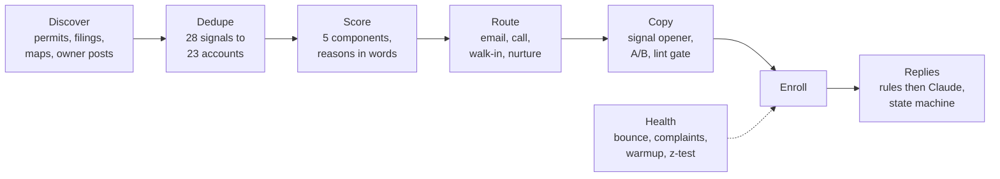

# gtm-engine

[](https://github.com/layllabs/GTM-Engine/actions/workflows/ci.yml)

Portfolio: [agent-first page](https://layllabs.github.io/GTM-Engine/) · [human page](https://layllabs.github.io/GTM-Engine/human.html) · [portfolio.json](https://layllabs.github.io/GTM-Engine/portfolio.json) · [llms.txt](https://layllabs.github.io/GTM-Engine/llms.txt)

A signal-based outbound engine I built and run for selling card payment
processing to local business owners, with a second lane for referral
partners. Discovery agents find businesses where something just happened
(a new permit, a new filing, an owner complaining about fees), the engine
dedupes, scores and routes them, writes and lints the copy, classifies
replies, and checks deliverability before anything sends.

Everything here runs. One command, no dependencies beyond Python 3.11+,
synthetic data in, a morning scoreboard out.

```
git clone <this repo> && cd gtm-engine
python -m gtm run
```

```
engine run 2026-10-01: 28 signals -> 23 accounts
  tiers    {'A': 7, 'B': 9, 'C': 3, 'DQ': 4}
  actions  {'sequence_and_call': 2, 'visit_and_sequence': 5, 'sequence': 4, 'call_first': 5, 'suppress': 2, 'nurture': 1, 'disqualify': 4}
  drafts   40 (0 failing lint)
  replies  {'interested': 1, 'not_now': 2, 'question': 1, 'wrong_person': 1, 'unsubscribe': 1, 'meeting_request': 1, 'out_of_office': 1, 'not_interested': 1, 'bounce': 1}
  inboxes  {'ok': 2, 'watch': 1, 'pause': 2, 'warming': 1}  retire: ['sender-two.example']
  wrote    examples/output/scoreboard.md
```

Open [`examples/output/scoreboard.md`](examples/output/scoreboard.md) for
the ranked list, call sheet, classified replies and mailbox health, and
[`examples/output/drafts.md`](examples/output/drafts.md) for every email
the run produced.

## The pipeline



| Step | Code | Doc | Config |
|---|---|---|---|
| 1. Discover | [`gtm/discover.py`](gtm/discover.py) | [workflow](docs/workflows/01-signal-discovery.md) | [`schemas/signal.schema.json`](schemas/signal.schema.json) |
| 2. Dedupe and score | [`gtm/dedupe.py`](gtm/dedupe.py), [`gtm/score.py`](gtm/score.py) | [workflow](docs/workflows/02-dedupe-and-score.md) | [`config/icp/`](config/icp) |
| 3. Route, write, gate | [`gtm/route.py`](gtm/route.py), [`gtm/copywriting.py`](gtm/copywriting.py) | [workflow](docs/workflows/03-route-and-sequence.md) | [`config/routing.json`](config/routing.json), [`config/sequences/`](config/sequences) |
| 4. Replies | [`gtm/replies.py`](gtm/replies.py), [`gtm/lifecycle.py`](gtm/lifecycle.py) | [workflow](docs/workflows/04-reply-handling.md) | [`prompts/reply-classifier.md`](prompts/reply-classifier.md) |
| 5. Health | [`gtm/health.py`](gtm/health.py) | [workflow](docs/workflows/05-deliverability-health.md) | [`config/deliverability.json`](config/deliverability.json) |

## What to look at, depending on what you care about

**Systems thinking.** [`docs/architecture.md`](docs/architecture.md) and
the three [decision records](docs/decisions): why signals instead of
lists, why a shadow CRM, why a written runbook before n8n.

**CRM logic.** [`docs/crm/lifecycle.md`](docs/crm/lifecycle.md) is the
account state machine as a Mermaid diagram. A test parses the diagram and
fails if it drifts from the code. [`docs/crm/data-model.md`](docs/crm/data-model.md)
is the ER diagram and what syncs to the system of record.

**Copy.** [`docs/copy/`](docs/copy) has every sequence with a line-by-line
explanation of why each sentence is there, what v1 got wrong, and what
the A/B test is meant to settle. The linter that gates all of it is in
[`gtm/copywriting.py`](gtm/copywriting.py).

**Working with models.** [`prompts/`](prompts) has every prompt the engine
uses, each with a JSON schema for its output and a non-model fallback.
Rules handle the easy 80% of replies; Claude only sees what's left.

**Reviewed.** An AI screener with no context read this repo cold and scored
it 6/10 with nine red flags. [The report and the fixes](docs/reviews/2026-10-15-cold-ai-screen.md)
are published. Changes since: [CHANGELOG.md](CHANGELOG.md).

**Connecting tools.** One registry (`gtm/integrations/registry.py`) knows how
each tool authenticates and how to prove a credential works with one
read-only call. `python -m gtm connect` reports status for all nine.
[`skills/connect-tools/SKILL.md`](skills/connect-tools/SKILL.md) is the
procedure an agent or a person follows to add one.

**SEO and AEO.** [`docs/aeo/`](docs/aeo) explains what search engines and
answer engines each need and how the portfolio pages meet it; `scripts/aeo_audit.py`
checks it in CI. The same checklist applies to any GTM content.

**Runbooks and leadership.** [Sending-domain setup](docs/runbooks/sending-domain-setup.md)
from registration to first cold send. [SDR onboarding 30/60/90](docs/leadership/sdr-onboarding-30-60-90.md)
with the coaching rules I hold myself to. [Glossary](docs/glossary.md) and
[open questions](docs/open-questions.md) for anyone, human or agent, who wants the terms and the gaps.

**Deliverability.** [workflow 05](docs/workflows/05-deliverability-health.md):
lookalike sending domains, warmup floors, bounce and complaint thresholds
that pull a mailbox out of rotation, a domain retirement rule, and a
z-test so a copy variant isn't crowned on noise.

## Layout

```
gtm/            pipeline code, one module per step, stdlib only
gtm/integrations/  connector registry: GitHub, Smartlead, Outreach, Salesforce, HubSpot, Apollo, ZeroBounce, Clay, Anthropic
skills/         agent-followable procedures (connect-tools)
config/         ICPs, routing rules, sequences, deliverability thresholds
schemas/        JSON schemas for every data shape and LLM output
prompts/        every prompt, versioned with the code
data/sample/    synthetic signals, replies, mailbox stats
docs/           architecture, workflows (Mermaid), CRM model, copy, decisions, experiments, SEO/AEO, reviews, portfolio site
examples/       output of the last run, committed so you can read it without running
tests/          27 tests, including one that keeps the diagram and code in sync
```

## Commands

```
python -m gtm run                 full run on sample data, writes examples/output/
python -m gtm run --as-of today   use today's date for recency scoring
python -m gtm lint-copy           lint every sequence template (CI runs this)
python -m gtm eval-replies        rules classifier vs 28 labeled replies (CI runs this)
python -m gtm health              deliverability check only
python -m gtm connect             which tools are configured; read-only probe of each
python scripts/aeo_audit.py       SEO/AEO checklist against the portfolio pages
python -m unittest discover -s tests -t .
```

## Honest notes

- All business names, people, domains and phone numbers in this repo are
  made up. The employer, the real CRM and the real sending domains are
  deliberately not named.
- The code is AI-assisted. The design, the scoring model, the routing
  rules, the copy and the decisions are mine. I treat the model as a fast
  pair of hands and review everything that touches a prospect.
- This repo is the decision layer. Discovery scrapers, the email
  verifier, the sequencer and CRM sync are API calls in the production
  version and are not published here; this version reads CSV and JSON in
  the same shapes, which is the point of the schemas. If you want to see
  how a specific integration is wired, ask.
- The whole repo landed in one commit because it was extracted from a
  private working repo. History before that is not public.
- Numbers in the sample run are synthetic. Real results are discussed in
  conversation, not published.

[`AGENTS.md`](AGENTS.md) is a short orientation for any LLM pointed at this repo.
