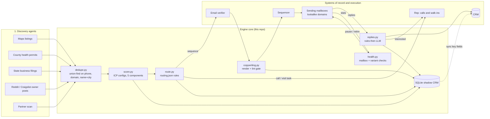

# Architecture

## System view

## Design choices that matter

**Signals, not lists.** The engine never starts from "all restaurants in
LA". It starts from an event (a permit, a filing, an owner complaining
about fees) and asks whether that business fits an ICP. Timing is most of
the battle in SMB payments: the best moment is when a contract is about
to be signed or has just started hurting.

**Config over code.** ICPs, scoring weights, routing rules, sequences and
deliverability thresholds are JSON in `config/`. Opening a new vertical or
territory is a new file, not a code change. Schemas for each live in
`schemas/`.

**Every score explains itself.** `reasons` is required on every account.
A rep looking at the call list sees "new_health_permit 9d ago; direct
email found", not just "87".

**Lint is a gate, not a suggestion.** A draft that fails lint (em dashes,
unfilled variables, too long, spam phrases, more than one question)
blocks enrollment for that account. The templates are linted in CI with a
worst-case long business name, which is how the 49 character subject line
in an earlier version got caught.

**Deterministic first, model second.** Rules handle bounces, OOO and
unsubscribes. Claude handles what the rules can't, against a JSON schema,
with a non-model fallback for every step. See [`prompts/`](../prompts).

**Shadow CRM.** The CRM stays the system of record for pipeline. The
SQLite database holds what the CRM can't flexibly hold: raw signals,
score components, copy variants, reply labels and the full event log.
See [ADR 002](decisions/002-shadow-crm.md).

**Explicit lifecycle.** Accounts move through a validated state machine
with an append-only event log. See [`crm/lifecycle.md`](crm/lifecycle.md).

## Where each step runs

| Step | Today | Trigger |
|---|---|---|
| Discovery | Claude agents + scripts, output in the signal shape | weekly batch |
| Dedupe, score, route | `python -m gtm run` | after each batch |
| Copy + lint | `python -m gtm run`, opener rewrite by Claude | after routing |
| Verification | email verifier API before enrollment | before enrollment |
| Reply handling | Claude session against sequencer inbox, rules first | daily |
| Health | `python -m gtm health` + placement tests | daily before send window |
| Demo / CI | GitHub Actions on every push and nightly | see `.github/workflows/` |

Orchestration lives in a Claude-native runbook rather than n8n for now.
See [ADR 001](decisions/001-claude-orchestration-before-n8n.md).
