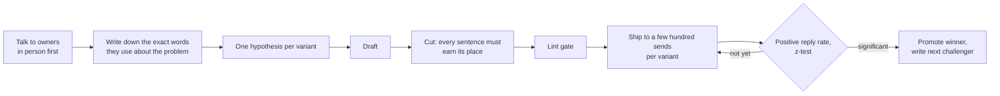

# Copy: what I wrote and why

The sequences live as config in [`config/sequences/`](../../config/sequences)
so the engine can render and lint them. This folder is the reasoning
behind them: the bet each line makes, what I cut, and what the test is
designed to tell me.

- [Local merchant sequence](local-merchant-v2.md): direct to owner-operated shops
- [Referral partner sequence](referral-partner-v1.md): businesses that serve many merchants

## Process

## Principles I hold myself to

1. **Lead with their world, not my product.** The first line is about
   something that happened to them. The product shows up in line two.
2. **Ask for something small and useful to them.** "Send me one
   statement" beats "15 minutes this week?" for a shop owner. The statement
   review is the meeting.
3. **Use their words.** Owners say "card fees" and "my statement". They do
   not say "payment processing solutions" or "interchange optimization".
4. **One question.** If there are two asks, neither gets answered.
5. **No links, no attachments, no images in the first touch.**
6. **Sound like a person.** No em dashes, no "I hope this finds you well",
   no "quick question" followed by three paragraphs.
7. **Measure positive replies, not opens or total replies.** An
   unsubscribe is a reply.
