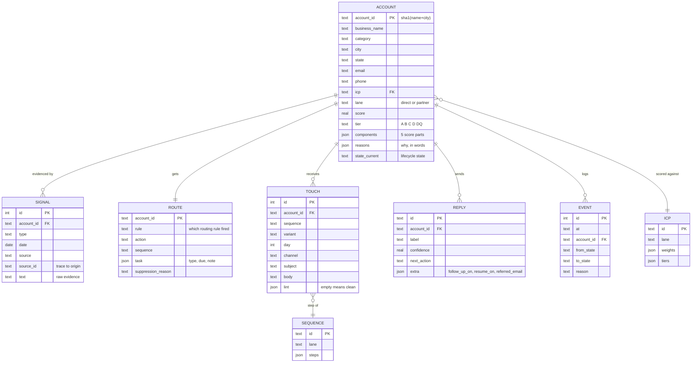

# CRM data model

Two layers:

- **System of record CRM** (Salesforce, HubSpot or Attio): accounts,
  contacts, opportunities, owner. What leadership reports on.
- **Shadow CRM** (SQLite, `gtm/store.py`): everything the engine needs
  that would otherwise mean asking RevOps for a new custom field every week.



## What syncs to the system of record

Only what a manager or another rep needs:

| Shadow field | CRM field | Why it syncs |
|---|---|---|
| `tier` | Account priority picklist | Drives views and territory reports |
| top `reasons` | Account description, first line | Context for anyone who opens the record |
| `state_current` in engaged / meeting | Opportunity created | Pipeline lives in the CRM |
| reply `follow_up_on` | Task with due date | Shows on the rep's task list |
| suppression | Do-not-contact checkbox | Compliance must be visible everywhere |

Everything else (score components, every signal, every draft, every lint
result, every state change) stays local. It is queryable with plain SQL:

```sql
-- Which signal types turn into meetings?
SELECT s.type, COUNT(DISTINCT e.account_id) AS meetings
FROM events e JOIN signals s USING (account_id)
WHERE e.to_state = 'meeting'
GROUP BY s.type ORDER BY meetings DESC;

-- Accounts that went quiet: sequenced more than 14 days, no reply
SELECT a.business_name, MAX(e.at) AS since
FROM accounts a JOIN events e USING (account_id)
WHERE a.state_current = 'sequenced'
GROUP BY a.account_id HAVING since < date('now', '-14 days');
```

## Keys and identity

- `account_id` is derived (sha1 of normalized name + city), so the same
  business gets the same ID on every run without a lookup service.
- `signal.source_id` keeps the link back to the original permit, filing,
  post or listing for audit.
- Replies match accounts by sender email. Bounces come from a mailer
  daemon, so in production they match by original message ID instead.
