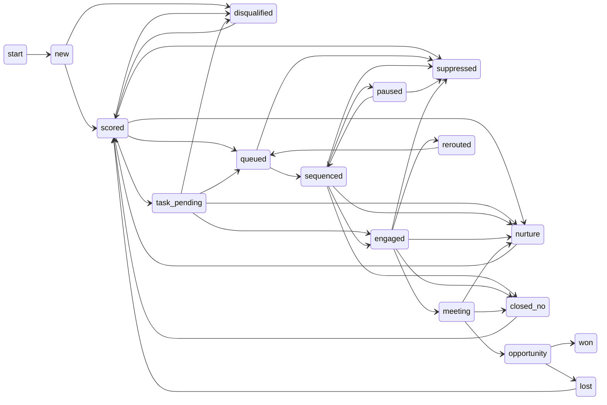

# Account lifecycle

Every account is in exactly one state. Every move is validated against the
transition table in [`gtm/lifecycle.py`](../../gtm/lifecycle.py) and written
to an append-only event log (`events` table, `examples/output/events.jsonl`).
An illegal jump (for example `new` straight to `won`) raises an error instead
of silently corrupting the pipeline.

This diagram is tested: `tests/test_engine.py` parses the edges below and
fails CI if they drift from the code.

## What moves an account

| From | To | Trigger |
|---|---|---|
| new | scored / disqualified | `score.py` finds an ICP fit, or an exclusion / territory miss |
| scored | queued | routing rule picks a sequence |
| scored | task_pending | tier A or B but phone only: rep calls to get an email first |
| scored | suppressed | email, domain or phone on the suppression list |
| queued | sequenced | every draft for the account passes the lint gate |
| sequenced | engaged | reply labeled interested, question, meeting_request or wrong_person |
| sequenced | paused | out-of-office; resumes the day after the return date |
| sequenced | nurture | not now; follow-up task created on the date they named |
| sequenced | closed_no | not interested |
| any active | suppressed | unsubscribe or hard bounce |
| engaged | rerouted | wrong person; the referred contact gets step 1 |
| nurture / closed_no / lost / disqualified | scored | a NEW signal arrives, account is rescored from scratch |

## Why recycling goes back through `scored`

A "no" in March is not a "no" forever. When an ownership change or a new
permit shows up on a closed account, it re-enters at `scored`, gets a fresh
score with the new signal, and routes like any other account. Nothing jumps
straight back into a sequence without being rescored.

## Terminal states

`won` and `suppressed` have no exits. Suppression is permanent by design.
