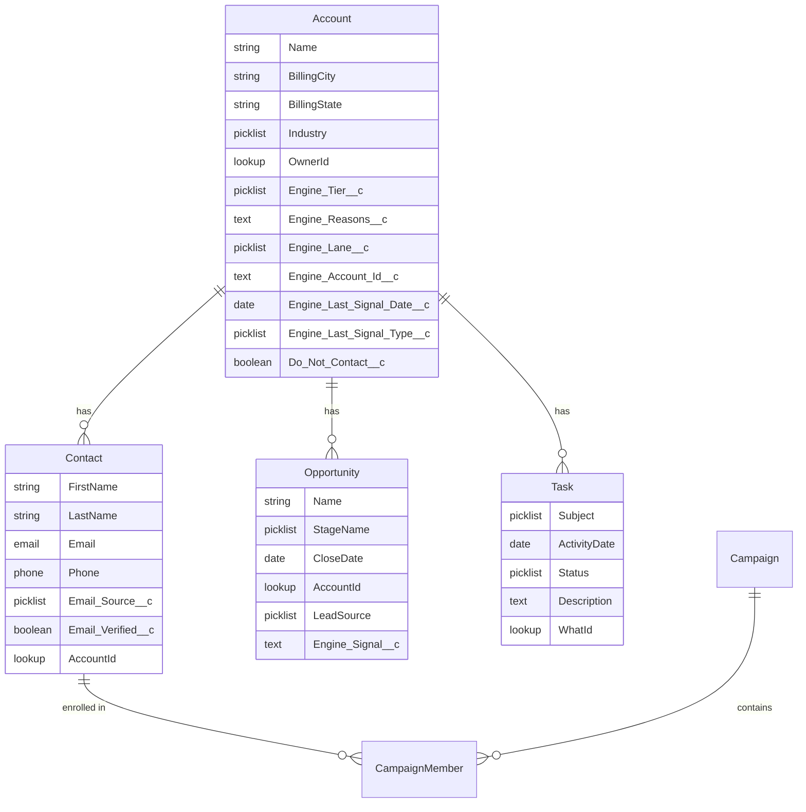

# Salesforce (and HubSpot) field map

What the engine writes to the system of record, where, and why. The
principle from ADR 002: the CRM gets what a manager or another rep needs;
everything else stays in the shadow CRM and is queryable with SQL.

## Object model used

## Field map

| Engine field | Salesforce | HubSpot | Direction | Notes |
|---|---|---|---|---|
| `account_id` | `Account.Engine_Account_Id__c` (external id, unique) | `company.engine_account_id` | engine to CRM | Upsert key. Never overwritten. |
| `business_name` | `Account.Name` | `company.name` | engine to CRM on create only | CRM name wins after create. |
| `city`, `state` | `Account.BillingCity/State` | `company.city/state` | engine to CRM on create only | |
| `category` | `Account.Industry` | `company.industry` | engine to CRM on create only | Mapped through a picklist table; unknown categories go to "Other". |
| `owner` | `Account.OwnerId` | `company.hubspot_owner_id` | engine to CRM | From `config/territories.json`. CRM reassignment flows back as a new rule, not a one-off. |
| `tier` | `Account.Engine_Tier__c` | `company.engine_tier` | engine to CRM, every run | Drives list views. |
| `reasons[0:2]` | `Account.Engine_Reasons__c` | `company.engine_reasons` | engine to CRM, every run | First two reasons, joined. Enough for a rep to see why. |
| `lane` | `Account.Engine_Lane__c` | `company.engine_lane` | engine to CRM | direct / partner. |
| strongest signal type + date | `Engine_Last_Signal_Type__c`, `Engine_Last_Signal_Date__c` | `company.engine_last_signal_*` | engine to CRM | The "why now". |
| `email`, `field_sources.email` | `Contact.Email`, `Contact.Email_Source__c` | `contact.email`, `contact.email_source` | engine to CRM | Source picklist: crm, apollo, hunter, pattern_guess, inbound. |
| verification result | `Contact.Email_Verified__c` | `contact.email_verified` | engine to CRM | False blocks sequence enrollment via validation rule. |
| suppression | `Account.Do_Not_Contact__c` | `company.do_not_contact` | both ways | CRM is authoritative; engine reads it into `suppression.csv` nightly. |
| state in {engaged, meeting} | `Opportunity` created, Stage = Discovery | `deal` created | engine to CRM, once | `LeadSource` = Outbound Engine; `Engine_Signal__c` = the signal that started it. |
| state = won / lost | read from `Opportunity.StageName` | `deal.dealstage` | CRM to engine | Closes the loop for `signals_to_meetings` and win-rate by signal. |
| reply `follow_up_on` | `Task` (Subject = Follow up, ActivityDate) | `task` | engine to CRM | Shows on the rep's list. |
| routing task (call / visit) | `Task` (Subject = Call or Visit, Description = note) | `task` | engine to CRM | Due from `routing.json`. |
| sequence enrollment | `CampaignMember` (Campaign per sequence+variant) | `contact.engine_sequence` | engine to CRM | Variant is in the campaign name so reporting splits A/B. |
| events log | not synced | not synced | | Queryable in the shadow CRM only. |
| score components, drafts, lint | not synced | not synced | | Same. |

## Sync rules

1. Upsert on `Engine_Account_Id__c`. Never match on name; the engine's
   dedupe already did that, and name matching in the CRM creates duplicates.
2. Create-only fields are never overwritten by the engine after the first
   sync. The CRM is where humans fix names and addresses.
3. `Do_Not_Contact__c` is read before every run. A rep ticking it in the
   CRM is the fastest path to suppression.
4. Opportunities are created once per account per engagement; a recycled
   account that re-engages gets a new opportunity, not a reopened one.
5. Every write carries the run date in `Engine_Last_Synced__c` so a stale
   record is visible.
6. Batched: 200 records per API call, nightly. A field change on one
   account does not trigger a call.

## Validation rules worth adding on the CRM side

- `Email_Verified__c = false` blocks adding the contact to any
  Engine campaign.
- `Do_Not_Contact__c = true` blocks Task creation with Subject = Call.
- `Engine_Tier__c = 'DQ'` hides the account from outbound list views.
