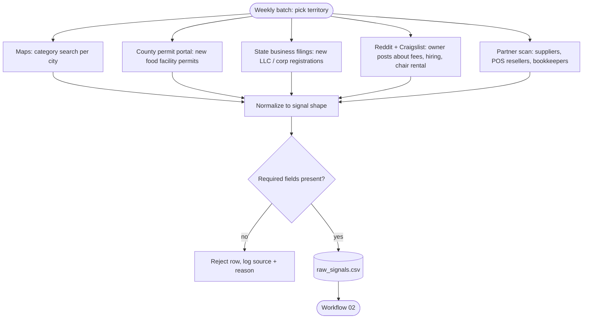

# Workflow 01: Signal discovery

**Trigger:** weekly batch, one territory at a time.
**Output:** rows in the signal shape (`schemas/signal.schema.json`), one CSV per run.
**Code:** `gtm/discover.py` (loader and validation).

## Why these sources

| Source | Signal | Why it predicts a good conversation |
|---|---|---|
| County health permits | `new_health_permit` | A new food business picks a processor in its first weeks, usually in a hurry. |
| State filings | `new_business_filing` | Same moment, one step earlier. |
| Maps listing changes | `ownership_change`, `review_spike` | New owners inherit old contracts. More volume makes fees hurt more. |
| Owner posts | `processor_complaint`, `hiring_post` | The owner said the pain out loud. Highest intent signal we have. |
| Partner scan | `partner_program_page` | Already refers vendors to their customers, so the referral ask is familiar. |

Listing-only rows (`listing_only`) are kept but score low. A business
existing is not an event.

## Rules

- Every row keeps `source` and `source_id` so any account can be traced
  back to the exact post, permit or listing that created it.
- Owner posts are used to pick the opener topic. They are never quoted
  and the platform is never named in outreach (see `prompts/opener-qa.md`).
- Discovery agents only write rows. They never contact anyone.
- Owner posts on public forums are read for signal only: the post is
  never quoted, the platform is never named, and no account is ever
  created on those sites to pull data. If a source's terms prohibit
  automated reads, that source is dropped, not worked around.

## Failure modes

| What breaks | What happens |
|---|---|
| Source changes its layout | That agent emits zero rows; scoreboard shows the source dropped to 0. |
| Row missing name / type / source | Rejected at load with the row number. The run stops so bad data never reaches scoring. |
| Same business from 3 sources | Expected. Workflow 02 merges them. |
