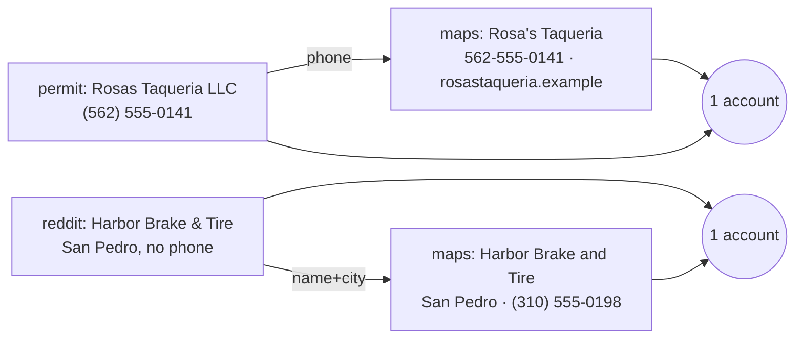
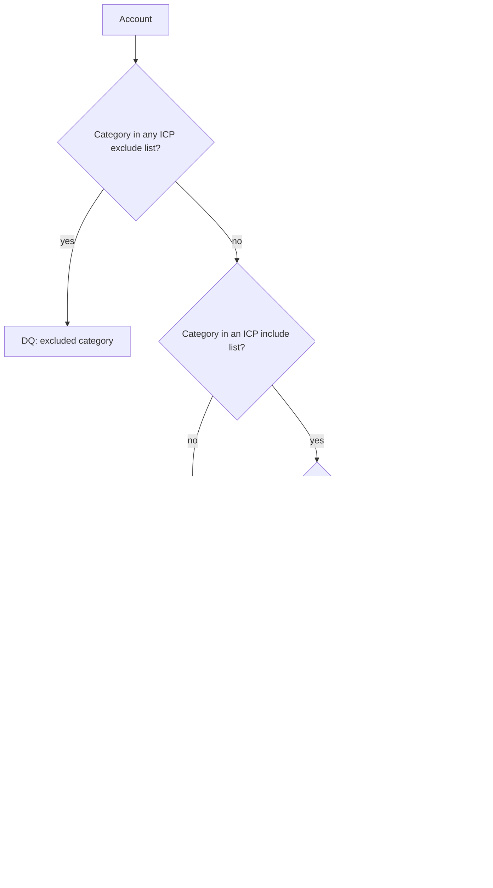

# Workflow 02: Dedupe and score

**Trigger:** after every discovery batch.
**Code:** `gtm/dedupe.py`, `gtm/score.py`. **Config:** `config/icp/*.json`.

## Dedupe

Rows are linked if they share any key. Linking is transitive.



Keys: 10 digit phone, website domain, normalized name + city. Name
normalization strips punctuation, legal suffixes and store numbers and
turns `&` into `and`, so "Rosa's Taqueria LLC" and "Rosas Taqueria" match.
When fields conflict, the source with the best contact data wins (maps,
then partner scan, then permits, filings, posts).

In the sample run: **28 raw signals become 23 accounts**.

## Enrich (between dedupe and score)

Missing fields go through the waterfall in `config/enrichment.json`: CRM
first (free), then public sources, then paid providers, each field with a
cent budget. A pattern-guessed email is flagged `needs_verification` and
routes to call-first, never to a sequence. The scoreboard shows hit rate
and cost per hit by provider, which is how a provider gets demoted.

## Assign (after score)

`config/territories.json` maps zip prefix, state or city to an owner, with
deterministic round-robin for shared territories and a partner-lane
override. The owner lands on the scoreboard and in the shadow CRM.

## Score



| Component | How it's computed | Direct weight | Partner weight |
|---|---|---|---|
| category_fit | per-category weight from the ICP file (restaurant 1.0, retail 0.7); excluded categories DQ before scoring | 25 | 35 |
| signal_strength | strongest signal, +0.1 per extra distinct type | 30 | 15 |
| recency | `0.5 ^ (age / half_life)`; 30 day half life direct, 90 partner; listings get 0.1 | 20 | 10 |
| reachability | email .5, phone .3, address .1, named contact .1 | 15 | 20 |
| size_proxy | review count on a log scale between floor and ceiling | 10 | 20 |

The partner model weights fit and size over freshness on purpose. A
restaurant supplier with 200 accounts is worth calling whether or not
something happened this week. A taqueria is worth calling *because*
something happened this week.

Every scored account carries `reasons`, for example:

```
Harbor Brake and Tire  96.5  A  processor_complaint 4d ago (reddit); direct email found
Mesa Verde Market      49.0  C  direct email found; small footprint (8 reviews)
```

## Tuning

Weights are a starting hypothesis. Once there are 30+ outcomes per tier,
compare positive reply rate by tier. If B converts like A, the A threshold
is too high. If a signal type never produces a meeting, cut its strength.
Change the JSON, rerun, diff the scoreboard.
