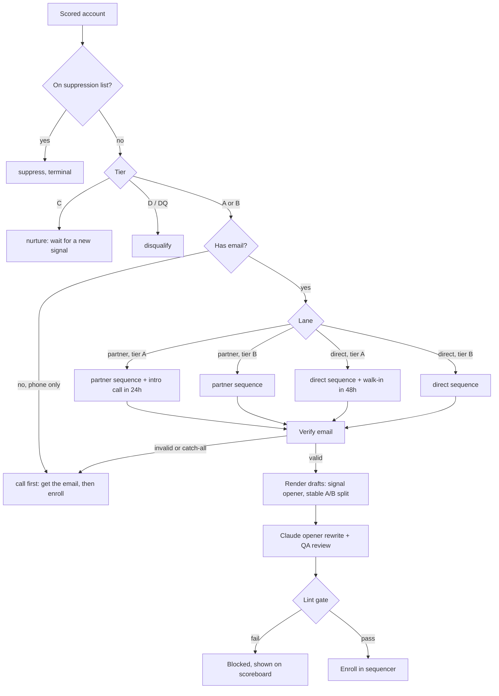

# Workflow 03: Route, write, gate, enroll

**Trigger:** after scoring.
**Code:** `gtm/route.py`, `gtm/copywriting.py`.
**Config:** `config/routing.json`, `config/sequences/*.json`, `data/*/suppression.csv`.

## Routing is a table, not code

`config/routing.json` is evaluated top to bottom, first match wins. To
send phone-only partners to a different task, edit the JSON. The code
only knows how to match facts (`lane`, `tier`, `has_email`, `has_phone`,
`has_address`, `suppressed`) against rules.

A bug this structure caught early: an earlier rule set sent phone-only
partner accounts into an email sequence. Adding `has_email: true` to the
partner rules fixed it, and `test_no_email_never_enrolls` keeps it fixed.

## Copy

The opener is chosen from the account's strongest signal. Permit gets the
permit line, fee complaint gets the fee line. Variants A and B are
assigned by hashing the account ID, so a rerun never flips someone to the
other variant mid-test.

## Lint gate

| Check | Limit | Why |
|---|---|---|
| Em / en dash | 0 | Reads as machine-written. Owners notice. |
| Unfilled `{{variables}}` | 0 | "Hi {{first_name}}" is the fastest way to burn a domain. |
| Words | 90 direct, 100 partner | Owners read on a phone between customers. |
| Questions | 1 | One clear ask. |
| Links | 0 | Links in a first touch hurt placement and look like phishing to a small business owner. |
| Spam phrases | 0 | "guarantee", "act now", "100%", etc. |
| Subject length | 45 chars | Linted with a worst-case long business name, not the average. |

`python -m gtm lint-copy` runs every opener against every email step (38
combinations) and exits non-zero on any failure. CI runs it on every push.

See [`docs/copy/`](../copy) for the sequences themselves and the reasoning behind each line.
