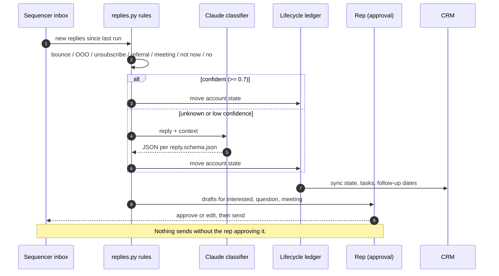

# Workflow 04: Daily reply handling ("run the engine")

**Trigger:** every morning, plus on demand.
**Code:** `gtm/replies.py`, `gtm/lifecycle.py`. **Prompt:** `prompts/reply-classifier.md`.

## Label to action

| Label | Next action | State move | Extracted |
|---|---|---|---|
| bounce | suppress, re-verify that list | suppressed | |
| out_of_office | pause sequence | paused | `resume_on` = day after return |
| unsubscribe | suppress on every channel | suppressed | |
| wrong_person | create referred contact, send step 1 | engaged then rerouted | `referred_email` |
| meeting_request | confirm time, create opportunity | engaged then meeting | |
| not_now | stop sequence, dated follow-up task | nurture | `follow_up_on` |
| not_interested | stop, recycle only on a new signal | closed_no | |
| question | draft answer for approval | engaged | |
| interested | draft reply for approval, create opportunity | engaged | |

## Sample run output

From `examples/output/scoreboard.md`:

| Reply | Label | Next | Result |
|---|---|---|---|
| "Sure, here is last month's statement..." | interested | reply | -> engaged |
| "Locked in a contract until March. Reach out then." | not_now | nurture (2027-03-01) | -> nurture |
| "How much does it cost to switch?..." | question | reply | -> engaged |
| "Not the right person, my husband Tom handles..." | wrong_person | reroute (tom@...) | -> rerouted |
| "Interesting. ~200 restaurant accounts. Thursday at 2?" | meeting_request | book | -> meeting |
| "Out of the office until October 8" | out_of_office | pause (2026-10-09) | -> paused |
| "Delivery Status Notification (Failure) 550 5.1.1" | bounce | suppress | unmatched, matched by message id |

## Why rules before the model

Most replies are boring: bounces, auto-replies, unsubscribes. Rules catch
those for free and never hallucinate a meeting. The rules are also the
eval baseline: `data/sample/reply_eval.jsonl` is a labeled set (28 cases
today, including the traps: "do not send me your statement review",
"reach out to me in March", an OOO that says "not interested" in passing).
`python -m gtm eval-replies` scores the rules against it and CI fails
below 90%. When the classifier prompt changes, it runs against the same
set and has to beat the rules, not just "look right".

Rules are precedence-ordered: negatives (not_interested, not_now) sit
above positives so a positive keyword inside a refusal never wins.
