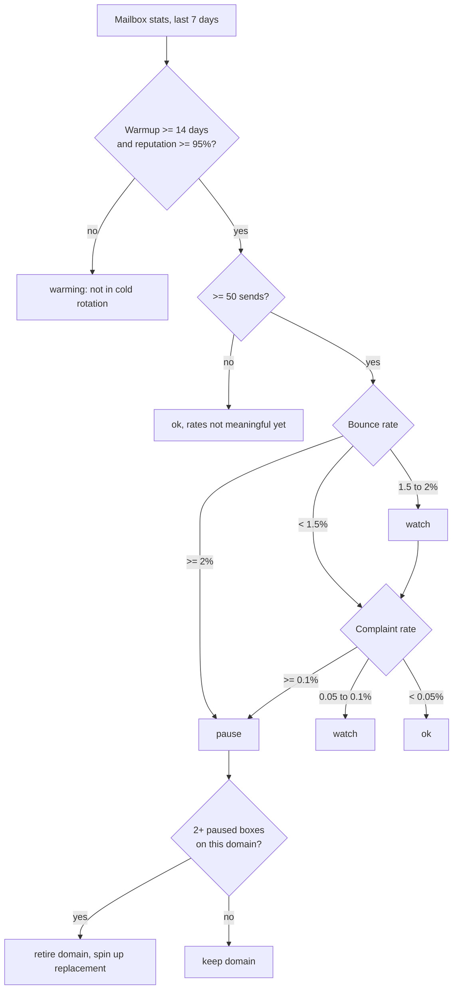

# Workflow 05: Deliverability health

**Trigger:** every morning before the send window.
**Code:** `gtm/health.py`. **Config:** `config/deliverability.json`.



## Infrastructure rules

1. Cold email never sends from the primary brand domain. Sending runs on
   lookalike domains, a few mailboxes each, mixed Google and Microsoft.
2. Every list is verified before enrollment. Catch-all and unknown do not
   enroll; they go to the call-first path instead.
3. Max 30 cold sends per mailbox per day.
4. Weekly placement test per domain.
5. SPF, DKIM and DMARC set on every sending domain before warmup starts.

## Copy variant check

Reply rate alone lies. The variant check compares **positive** reply rate
with a two-proportion z-test and refuses to crown a winner below
|z| = 1.96. From the sample run:

```
local-merchant-v2  A  420 sent  0.95% positive
local-merchant-v2  B  405 sent  0.25% positive
-> A leads on positive replies, z=1.31: not significant yet, keep testing
```

A looks almost 4x better. It isn't proven yet. The engine says so.

## Sample run

```
mbx-01  sender-one.example    ok
mbx-02  sender-one.example    watch    bounce 1.71%
mbx-03  sender-two.example    pause    bounce 2.94%
mbx-04  sender-two.example    pause    complaints 0.62%
mbx-05  sender-three.example  warming  warmup 9d, reputation 92%
mbx-06  sender-three.example  ok
domain sender-two.example: retire and replace
```
